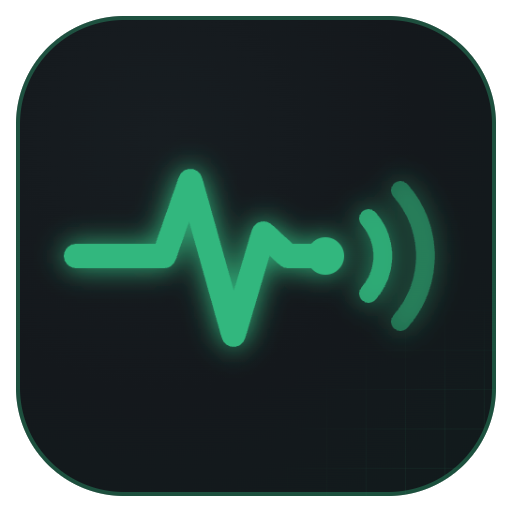
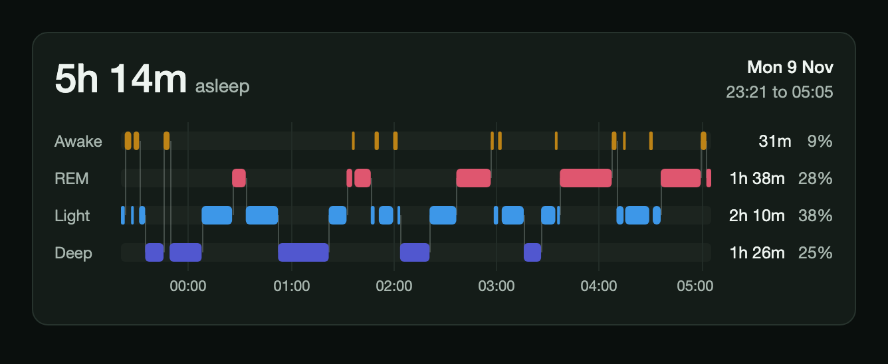
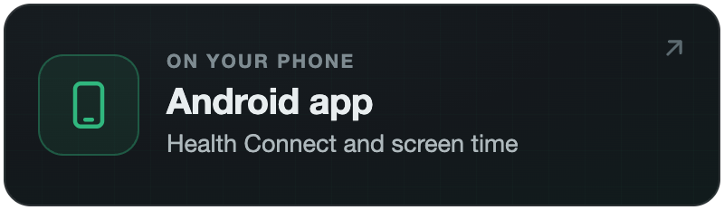
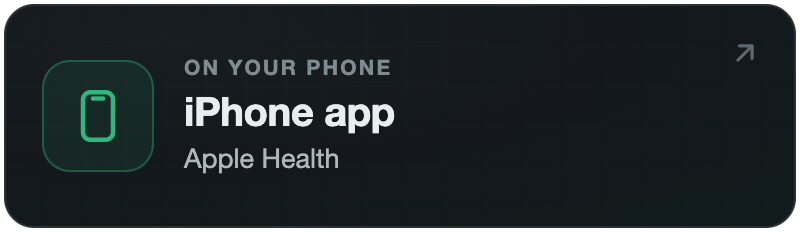
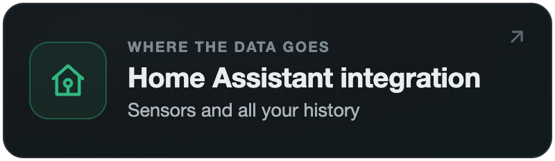
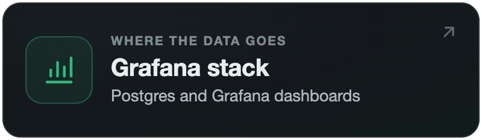
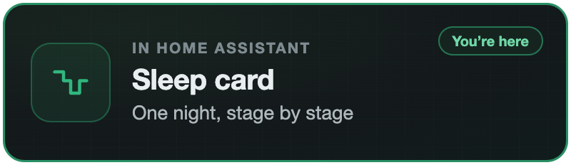

<p align="center">
  
</p>

<h1 align="center">Life Dashboard Sleep Card</h1>

<p align="center">
  <b>One night of sleep as a hypnogram on your Home Assistant dashboard.</b><br>
  Each stage in its own lane along the night's clock, with time asleep and each stage's duration and share.
</p>

<p align="center">
  <a href="https://my.home-assistant.io/redirect/hacs_repository/?owner=owen282000&repository=life-dashboard-sleep-card&category=plugin"></a>
  <a href="https://github.com/owen282000/life-dashboard-sleep-card/releases/latest"></a>
  <a href="https://www.home-assistant.io/"></a>
  <a href="https://github.com/owen282000/life-dashboard-sleep-card/blob/main/LICENSE"></a>
</p>

<p align="center">
  <a href="https://github.com/owen282000/life-dashboard-sleep-card#install"><b>Install</b></a>
  &nbsp;·&nbsp;
  <a href="https://github.com/owen282000/life-dashboard-sleep-card#configure">Configure</a>
  &nbsp;·&nbsp;
  <a href="https://github.com/owen282000/life-dashboard-sleep-card#already-use-the-home-assistant-companion-app">Companion&nbsp;app</a>
  &nbsp;·&nbsp;
  <a href="https://owen282000.com/life-dashboard/">Website</a>
</p>

<p align="center">
  <sub>Life Dashboard: <a href="https://github.com/owen282000/life-dashboard-companion-app">Android app</a> &nbsp;·&nbsp; <a href="https://github.com/owen282000/life-dashboard-companion-app-ios">iPhone app</a> &nbsp;·&nbsp; <a href="https://github.com/owen282000/life-dashboard-ha">Home Assistant integration</a> &nbsp;·&nbsp; <a href="https://github.com/owen282000/life-dashboard-stack">Grafana stack</a> &nbsp;·&nbsp; <b>Sleep card</b></sub>
</p>

<p align="center">
  <picture>
    <source media="(max-width: 600px)" srcset="https://raw.githubusercontent.com/owen282000/life-dashboard-sleep-card/main/docs/readme-hero-phone.png">
    
  </picture>
  <br><sub>Sample data</sub>
</p>

The card reads one sensor and draws what was in it: awake at the top, deep at the bottom, the night running left to right. It needs a sensor with sleep stages. That can be the [Life Dashboard integration](https://github.com/owen282000/life-dashboard-ha) 1.1.0 or newer, with the Life Dashboard Companion app on your phone, or on Android the official Home Assistant Companion app, without Life Dashboard.

Prefer a different look, or have a sensor with real state history, such as a sleep tracking app that reports live? Lavve's [Hypnogram card](https://github.com/Lavve/lovelace-hypnogram-card) handles both, and from version 0.1.9 it reads the same `stages` list with `stages_attribute: stages`.

<a href="https://play.google.com/store/apps/details?id=com.owen282000.lifedashboard&referrer=utm_source%3Dgh-card-readme%26utm_medium%3Dreadme"></a> <a href="https://apps.apple.com/app/apple-store/id6824075761?pt=128699800&ct=gh-card-readme&mt=8"></a>

## What you get

- **The shape of the night.** One lane per stage, with connectors between them, so the cycles show at a glance. A short blip stays visible, also on a night with 60 stages at phone width.
- **The numbers beside it.** Time asleep, the night's start and end, and each stage's duration and share of the night.
- **Every segment on demand.** Hover or tap a block for its stage, start, end and duration. On a keyboard, focus the plot and use the arrow keys, Home and End. Screen readers get a text table of the whole night.
- **Your locale and theme.** Hour ticks in your language and time format, the card's colors as CSS variables, and a layout that fits the sections view on a phone.
- **Honest about what's missing.** A night that only reports sleep draws an asleep lane and says so, and a sensor without stages shows an empty state instead of a broken chart.

## How it works

The card runs in your browser and reads two shapes of sensor, with nothing to configure:

- **Life Dashboard**: a sensor such as `sensor.your_phone_last_sleep_asleep`, with a `stages` attribute: a list of `{"stage": "...", "start": "<ISO 8601>", "end": "<ISO 8601>"}`.
- **The official Android Companion app**: `sensor.your_phone_health_connect_sleep_duration`, with the parallel lists `stageTypes`, `stageStartTimes` and `stageEndTimes`.

Stage values are `awake`, `light`, `deep`, `rem`, `sleeping`, `out_of_bed` and `unknown`, plus the Companion app's `awake_in_bed`, which counts as awake. Other names are drawn as neutral, and entries that cannot be read are skipped.

## Install

### Through the Home Assistant Marketplace

In **Settings > Marketplace** (HACS before Home Assistant 2026.11), search for **Life Dashboard Sleep Card** and download it. The button opens it in your Home Assistant straight away:

[](https://my.home-assistant.io/redirect/hacs_repository/?owner=owen282000&repository=life-dashboard-sleep-card&category=plugin)

On storage mode dashboards the resource is registered for you. If your dashboards are in YAML mode, add it yourself:

```yaml
lovelace:
  resources:
    - url: /hacsfiles/life-dashboard-sleep-card/life-dashboard-sleep-card.js
      type: module
```

### By hand

Copy `dist/life-dashboard-sleep-card.js` into the `www` folder of your Home Assistant configuration and add it as a resource of the type JavaScript module with the URL `/local/life-dashboard-sleep-card.js`.

## Configure

Add the card from the card picker, which offers the sensors that carry a night, or in YAML:

```yaml
type: custom:life-dashboard-sleep-card
entity: sensor.your_phone_last_sleep_asleep
title: Last night
```

| Option | Required | Description |
| --- | --- | --- |
| `type` | yes | `custom:life-dashboard-sleep-card` |
| `entity` | yes | A sensor with sleep stages, in either shape above |
| `title` | no | Text above the time asleep |

Language, time format and time zone follow your Home Assistant profile.

## Already use the Home Assistant Companion app?

Then on Android you don't need Life Dashboard for this card. It works on its own with the official Companion app, which needs:

- **The Android Companion app 2026.11.1 or newer**, the version that added the stages.
- **The Sleep duration sensor switched on**, under Settings, Companion app, Manage sensors, with Health Connect access for sleep. The stages only come with that sensor, not with the separate per-stage duration sensors.

The sensor's state is in minutes and the card doesn't use it: time asleep comes from the stages. Life Dashboard adds the history around the night: every day in long-term statistics, and both phones.

The iOS Companion app has no timeline of stages, so the card cannot draw a night from it. On an iPhone, use the Life Dashboard app and integration.

## Stage colors

The colors are CSS variables, so a theme can set them.

| Variable | Default |
| --- | --- |
| `--life-dashboard-sleep-awake` | `#bd8316` |
| `--life-dashboard-sleep-rem` | `#df566f` |
| `--life-dashboard-sleep-light` | `#3d97e8` |
| `--life-dashboard-sleep-deep` | `#5157cf` |
| `--life-dashboard-sleep-neutral` | `#8b94a8` |

## Part of Life Dashboard

This card sits on top of Life Dashboard's four projects, and you only install the parts you need. Put the app on each phone, then pick where the data goes. Both apps send the same payload, so an Android phone and an iPhone can share one Home Assistant or one stack. More at [owen282000.com/life-dashboard](https://owen282000.com/life-dashboard/).

<p align="center">
  <a href="https://github.com/owen282000/life-dashboard-companion-app"></a>
  <a href="https://github.com/owen282000/life-dashboard-companion-app-ios"></a>
  <a href="https://github.com/owen282000/life-dashboard-ha"></a>
  <a href="https://github.com/owen282000/life-dashboard-stack"></a>
  
</p>

## Privacy

The card only reads the sensor state Home Assistant already gives your browser, and makes no requests of its own. It has no telemetry or analytics, and there's no server of mine in the path.

## Documentation

- [Changelog](https://github.com/owen282000/life-dashboard-sleep-card/blob/main/CHANGELOG.md)
- [The Health dashboard](https://github.com/owen282000/life-dashboard-ha/blob/main/docs/dashboard.md) of the integration, to put this card on

## Help and contributing

Bugs go to [issues](https://github.com/owen282000/life-dashboard-sleep-card/issues) here. Questions go to the integration's [Discussions](https://github.com/owen282000/life-dashboard-ha/discussions). No GitHub account? Use the [feedback board](https://owen282000.com/life-dashboard/feedback/), which needs no account. Everything on it is public, so leave out health data, logs and webhook URLs.

Pull requests are welcome, see [CONTRIBUTING](https://github.com/owen282000/life-dashboard-sleep-card/blob/main/CONTRIBUTING.md). The card is one JavaScript file with no dependencies and no build step. Security problems go through a [private advisory](https://github.com/owen282000/life-dashboard-sleep-card/security/advisories/new).

## Support the project

Stars, shares and good bug reports all help. If you want to chip in for the evenings that go into it, there's [Ko-fi](https://ko-fi.com/owen282000). The card stays free and open source (MIT) either way.

MIT licensed. See [LICENSE](https://github.com/owen282000/life-dashboard-sleep-card/blob/main/LICENSE).

<p align="center">
  <sub>Made by <a href="https://github.com/owen282000">Owen Vogelaar</a> for the self-hosting and quantified self crowd.</sub><br>
  <sub>Google Play and the Google Play logo are trademarks of Google LLC.</sub><br>
  <sub>Apple, the Apple logo and App Store are trademarks of Apple Inc.</sub>
</p>
